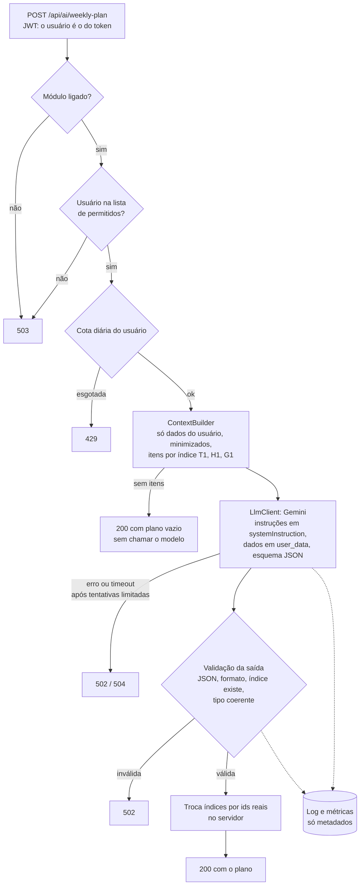

# LifeSync API

> API REST de produtividade pessoal em Spring Boot: **tarefas** com subtarefas, **hábitos** com streak e histórico, e **metas** com progresso, tudo atrás de autenticação JWT com proteção contra IDOR.

[](https://github.com/EndriwEngSoft/lifesync-api/actions/workflows/ci.yml)
[](https://www.oracle.com/java/technologies/downloads/#java21)
[](https://spring.io/projects/spring-boot)
[](https://www.postgresql.org/)
[](LICENSE)

**API no ar:** [Swagger UI](https://lifesync-api-ezkx.onrender.com/swagger-ui/index.html) · [Health check](https://lifesync-api-ezkx.onrender.com/actuator/health)

> A API roda no plano gratuito do Render, que desliga o serviço após 15 minutos sem acesso. O primeiro acesso depois disso pode levar cerca de um minuto para responder; os seguintes são normais.

---

## Índice

1. [Teste em 1 minuto](#teste-em-1-minuto)
2. [Decisões técnicas](#decisões-técnicas)
3. [Stack técnica](#stack-técnica)
4. [Arquitetura](#arquitetura)
5. [Endpoints da API](#endpoints-da-api)
6. [Módulo de IA](#módulo-de-ia)
7. [Testes](#testes)
8. [Como rodar localmente](#como-rodar-localmente)
9. [Variáveis de ambiente](#variáveis-de-ambiente)
10. [Deploy](#deploy)
11. [Licença](#licença)
12. [Autor](#autor)

---

## Teste em 1 minuto

Pelo navegador, sem instalar nada:

1. Abra o [Swagger UI](https://lifesync-api-ezkx.onrender.com/swagger-ui/index.html).
2. Em **Auth → `POST /api/auth/register`**, clique em *Try it out* e envie:
   ```json
   {
     "name": "Visitante",
     "username": "visitante01",
     "email": "visitante01@example.com",
     "password": "senha123"
   }
   ```
3. Copie o `accessToken` da resposta, clique em **Authorize** (cadeado no topo) e cole o token.
4. Crie um hábito em `POST /api/habits` e faça o check-in em `POST /api/habits/{habitId}/checkin`:
   ```json
   { "name": "Ler 20 páginas", "frequency": "DAILY", "targetPerPeriod": 1 }
   ```

Para ver a proteção contra IDOR, crie uma segunda conta e tente buscar o hábito da primeira: a resposta é `404`.

---

## Decisões técnicas

- **IDOR bloqueado por design.** Toda consulta de serviço é escopada por `(id, userId)`. Se o recurso existe mas pertence a outro usuário, a resposta é `404`, nunca `403`, para não revelar que o recurso existe.
- **IDs UUID**, não sequenciais. Evita enumeração de recursos e inferência de volume de dados pela URL.
- **Access e refresh tokens tipados.** O JWT carrega um claim `type` (`access`/`refresh`). Um refresh token vazado não autentica rotas protegidas, e um access token não serve para renovar a sessão.
- **Check-in calculado no fuso do usuário.** "Hoje" vem de um `Clock` injetado combinado com o fuso salvo no perfil (padrão `America/Sao_Paulo`), não do fuso do servidor (UTC na nuvem). Sem isso, um check-in às 23h em São Paulo cairia no dia seguinte. O `Clock` injetado também deixa os testes determinísticos.
- **Streak por período, não por data exata.** Hábitos `DAILY`, `WEEKLY` e `MONTHLY` comparam períodos: um check-in na sexta e outro na segunda seguinte contam como semanas consecutivas.
- **Check-in duplicado bloqueado em duas camadas.** Uma checagem rápida no serviço cobre o caso comum, e uma constraint `UNIQUE (habit_id, check_in_date)` no banco cobre a condição de corrida de duas requisições simultâneas. O `saveAndFlush` força o `INSERT` dentro do `try`, para a violação virar `409` em vez de erro genérico.
- **Soft delete em hábitos.** Remover um hábito marca `active = false`, preservando o histórico de check-ins e o streak.
- **Erros padronizados.** Um `@RestControllerAdvice` converte exceções de domínio, do framework e do banco no status HTTP correto (`400`, `401`, `403`, `404`, `405`, `409`, `415`), sempre com o mesmo corpo: `status`, `message`, `timestamp` e `path`.
- **Schema versionado e validado.** O Flyway cria o schema e o Hibernate roda com `ddl-auto: validate`: se uma entidade divergir da migration, a aplicação não sobe. O teste de integração prova isso contra um PostgreSQL real.

---

## Stack técnica

| Camada | Tecnologia |
|---|---|
| Linguagem / Runtime | Java 21, Spring Boot 4.1 |
| Web / Segurança | Spring Web, Spring Security (stateless) |
| Persistência | Spring Data JPA, Hibernate, PostgreSQL |
| Migrações | Flyway |
| Autenticação | JWT (jjwt 0.13.0), BCrypt |
| Validação | Bean Validation |
| Documentação | SpringDoc OpenAPI 3 (Swagger UI) |
| Testes | JUnit 5, Mockito, MockMvc, Testcontainers |
| Build | Maven (via wrapper `mvnw`) |
| Deploy | Docker (multi-stage), Render, Neon (PostgreSQL serverless) |
| CI | GitHub Actions |

---

## Arquitetura

### Estrutura de pacotes

Organização por domínio (feature package), não por camada técnica:

```
com.lifesync.api
├── common/       # BaseEntity, ApiErrorResponse (compartilhados entre domínios)
├── config/       # SecurityConfig, OpenApiConfig, ClockConfig
├── exception/    # Exceções de domínio + GlobalExceptionHandler
├── security/     # JwtTokenProvider, JwtAuthFilter, UserDetailsServiceImpl
├── auth/         # Registro, login, refresh de token
├── user/         # Perfil do usuário autenticado (/me)
├── task/         # Tarefas + subtarefas
├── habit/        # Hábitos + histórico de check-ins
├── goal/         # Metas + histórico de progresso
├── ai/           # Plano semanal gerado por LLM (cliente, contexto, validação, cota, métricas)
└── LifesyncApiApplication.java
```

### Relacionamento entre entidades

| Relação | Tipo | Comportamento no delete |
|---|---|---|
| `Task` → `User` | `@ManyToOne` (LAZY) | Sem cascade: apagar usuário não afeta tarefas. |
| `Task` → `Goal` | `@ManyToOne` (LAZY, opcional) | Sem cascade: apagar a meta apenas desvincula (`goal = null`). |
| `Task` → `SubTask` | `@OneToMany` (`cascade = ALL`, `orphanRemoval = true`) | Subtarefas são apagadas junto com a tarefa. |
| `Habit` → `Goal` | `@ManyToOne` (LAZY, opcional) | Sem cascade: desvincula ao apagar a meta. |
| `HabitHistory` → `Habit` | `@ManyToOne` (LAZY) | Sem cascade: preservado no soft delete do hábito. |
| `Goal` → `GoalProgress` | `@OneToMany` (`cascade = ALL`, `orphanRemoval = true`) | Histórico de progresso é apagado junto com a meta. |

### Migrações do banco (Flyway)

| Versão | Conteúdo |
|---|---|
| `V1__create_lifesync_schema.sql` | Schema base: `users`, `tasks`, `sub_tasks`, `habits`, `habit_history`. |
| `V2__create_goals_and_link_task_habit.sql` | Cria `goals` e `goal_progress`; adiciona FK `goal_id` em `tasks` e `habits`. |
| `V3__create_ai_request_log.sql` | Cria `tb_ai_request_logs`: uma linha de metadados por chamada ao LLM (sem o texto do prompt nem da resposta). |

---

## Endpoints da API

Base em produção: `https://lifesync-api-ezkx.onrender.com` · Base local: `http://localhost:8080` · Documentação interativa: `/swagger-ui/index.html`

Todos os endpoints exigem `Authorization: Bearer <access_token>`, exceto os de `/api/auth/*`, o Swagger e o `/actuator/health`.

#### Auth

| Método | Rota | Descrição |
|---|---|---|
| `POST` | `/api/auth/register` | Registra um usuário e retorna access + refresh token |
| `POST` | `/api/auth/login` | Autentica e retorna os tokens |
| `POST` | `/api/auth/refresh` | Recebe o refresh token no header `Authorization` e retorna um novo par de tokens |

#### User

| Método | Rota | Descrição |
|---|---|---|
| `GET` | `/api/users/me` | Retorna o perfil do usuário autenticado |
| `PUT` | `/api/users/me` | Atualiza o perfil (nome, timezone etc.) |

#### Task

| Método | Rota | Descrição |
|---|---|---|
| `POST` | `/api/tasks` | Cria uma tarefa (`goalId` opcional) |
| `GET` | `/api/tasks/{taskId}` | Busca uma tarefa por ID |
| `GET` | `/api/tasks` | Lista tarefas (paginado, filtro por status/prioridade) |
| `PUT` | `/api/tasks/{taskId}` | Atualiza campos da tarefa |
| `DELETE` | `/api/tasks/{taskId}` | Remove a tarefa (cascata para subtarefas) |
| `PATCH` | `/api/tasks/{taskId}/status` | Atualiza apenas o status |
| `POST` | `/api/tasks/{taskId}/subtasks` | Adiciona uma subtarefa |
| `PUT` | `/api/tasks/{taskId}/subtasks/{subtaskId}` | Atualiza o título de uma subtarefa |
| `PATCH` | `/api/tasks/{taskId}/subtasks/{subtaskId}` | Alterna conclusão da subtarefa |
| `DELETE` | `/api/tasks/{taskId}/subtasks/{subtaskId}` | Remove uma subtarefa |

#### Habit

| Método | Rota | Descrição |
|---|---|---|
| `POST` | `/api/habits` | Cria um hábito (frequência + meta por período) |
| `GET` | `/api/habits/{habitId}` | Busca um hábito por ID |
| `GET` | `/api/habits` | Lista hábitos (paginado) |
| `PUT` | `/api/habits/{habitId}` | Atualiza campos do hábito |
| `DELETE` | `/api/habits/{habitId}` | Soft delete (histórico é preservado) |
| `POST` | `/api/habits/{habitId}/checkin` | Registra o check-in de hoje (no fuso do usuário) |
| `GET` | `/api/habits/{habitId}/history` | Histórico de check-ins (paginado) |

#### Goal

| Método | Rota | Descrição |
|---|---|---|
| `POST` | `/api/goals` | Cria uma meta com valor alvo e unidade |
| `GET` | `/api/goals/{goalId}` | Busca uma meta por ID |
| `GET` | `/api/goals` | Lista metas (paginado, filtro por status) |
| `PUT` | `/api/goals/{goalId}` | Atualiza campos da meta |
| `DELETE` | `/api/goals/{goalId}` | Remove a meta (desvincula tasks/habits, apaga histórico) |
| `POST` | `/api/goals/{goalId}/progress` | Registra progresso (valor absoluto) |
| `GET` | `/api/goals/{goalId}/progress` | Histórico de progresso |

#### IA

| Método | Rota | Descrição |
|---|---|---|
| `POST` | `/api/ai/weekly-plan` | Gera o plano semanal do usuário autenticado (sem corpo). Em produção o módulo está desligado e a rota responde `503`. |

---

## Módulo de IA

`POST /api/ai/weekly-plan` lê as tarefas em aberto, os hábitos ativos e as metas em andamento do usuário do token, envia um resumo minimizado a um modelo de linguagem (Gemini) e devolve um plano semanal estruturado: resumo, prioridades, riscos e sugestões por dia. A resposta do modelo é tratada como entrada não confiável e só chega ao cliente depois de validada.

**Estado:** o módulo está **desligado em produção** (a rota responde `503`). Quando ligado, ele só atende os usuários de uma lista de permitidos, pensada para uma conta de demonstração com dados sintéticos; o motivo está no [ADR 0002](docs/ai/adr-0002-provedor-llm.md). Localmente ele roda com um provedor de mentira, sem chave e sem rede.

### Fluxo de uma chamada



### Decisões principais

- **Cliente HTTP próprio atrás de uma interface.** O Gemini é chamado por `RestClient`, atrás de `LlmClient`; trocar de provedor é mudar uma classe. O motivo não é incompatibilidade do Spring AI, e sim controle sobre a requisição e os erros ([ADR 0001](docs/ai/adr-0001-cliente-llm.md)).
- **O modelo nunca vê nem devolve ids reais.** Cada item vai com um índice curto (`T1`, `H1`, `G1`). O servidor guarda o mapa e só aceita índices que ele mesmo enviou, então um item inventado é rejeitado e é impossível apontar para o item de outro usuário.
- **Saída do modelo é entrada não confiável.** O esquema JSON enviado ao provedor é só um guia; o servidor valida de novo (formato, tamanhos, tipo, índice existente). Saída inválida vira `502` e é registrada, em vez de ser "consertada": a taxa de saídas inválidas é a medida de qualidade do prompt.
- **Falha fechada.** O cliente de mentira só existe com `lifesync.ai.provider=fake`; sem provider não há cliente algum e a rota responde `503`. Configuração incoerente (módulo ligado sem chave, por exemplo) derruba a subida da aplicação.
- **Lista de permitidos.** Mesmo ligado, o módulo só atende os ids de usuário em `LIFESYNC_AI_ALLOWED_USERS`. Lista vazia significa ninguém, um id inválido derruba a subida, e quem está fora recebe o mesmo `503` do módulo desligado, sem chamada ao provedor nem registro.
- **Cota diária calculada pelo próprio log**, no fuso do usuário, com um teto em 24 horas corridas que não depende do fuso (trocar o fuso do perfil não zera a contagem).
- **Erros com dono.** `429` é a cota do usuário, `503` é o módulo desligado, `502` é o provedor que falhou ou devolveu algo inválido, `504` é o provedor que demorou. Só erros passageiros (429, 5xx e timeout do provedor) são repetidos, com espera crescente e número máximo de tentativas.

O porquê de cada uma, o que foi descartado e o que ainda não foi verificado estão em [docs/ai/decisoes.md](docs/ai/decisoes.md).

### Segurança e LGPD

- **O que sai da API:** títulos de tarefas, nomes de hábitos e títulos de metas, com prioridade, datas, sequência e progresso. **Não saem:** nome, e-mail, username, senha, ids e descrições.
- **Títulos são texto livre**, então são saneados antes do envio: sem quebras de linha nem caracteres invisíveis, tamanho e quantidade limitados, e-mails, CPFs e números longos mascarados. O mascaramento é de melhor esforço: nomes próprios e telefones curtos passam.
- **Prompt injection:** as instruções ficam em `systemInstruction`; os dados do usuário vão separados, dentro de `<user_data>`, com `<` e `>` escapados para o conteúdo não fechar a tag. Nenhuma defesa de prompt é completa, por isso a saída é validada e os ids são resolvidos no servidor.
- **O log não guarda o texto do prompt nem da resposta**, só metadados (quem, quando, modelo, tokens, duração, status). As métricas só têm números e enums.
- **Chave do provedor** só em variável de ambiente (`LLM_API_KEY`), enviada em header, nunca em URL, log ou `toString`.
- **Política de dados do provedor:** na camada gratuita do Gemini o conteúdo pode ser usado para melhorar produtos e lido por revisores humanos. Por isso ela só foi usada com dados sintéticos, o módulo fica desligado em produção e, se for ligado, a lista de permitidos o restringe a uma conta de demonstração ([ADR 0002](docs/ai/adr-0002-provedor-llm.md)).

Cada ameaça, com a mitigação, o estado e o risco que sobra, está no [modelo de ameaças](docs/ai/modelo-ameacas.md).

### Exemplo de resposta

Resposta real do Gemini para um dos casos sintéticos da avaliação (um hábito diário com 21 dias de sequência e sem check-in hoje, um hábito semanal em dia e uma tarefa para dali a quatro dias); os ids são do banco de teste:

```json
{
  "summary": "Esta semana temos uma ótima oportunidade para manter a consistência nos hábitos e organizar pendências de saúde.",
  "priorities": [
    { "type": "HABIT", "id": "663f36cb-ae24-4db8-b44b-c64fc3d31251", "reason": "Hábito importante com risco de perder a sequência se não for mantido." },
    { "type": "TASK", "id": "2c9dbb6b-cb96-4a6f-be1f-d6ea7246a03a", "reason": "Tarefa pendente com prazo para a metade da semana." }
  ],
  "risks": ["Deixar de meditar e perder a sequência acumulada de dias."],
  "schedule": {
    "MONDAY": ["Praticar o hábito Meditar 10 minutos."],
    "TUESDAY": ["Praticar o hábito Meditar 10 minutos."],
    "WEDNESDAY": ["Praticar o hábito Meditar 10 minutos."],
    "THURSDAY": ["Marcar consulta no dentista.", "Praticar o hábito Meditar 10 minutos."],
    "FRIDAY": ["Praticar o hábito Meditar 10 minutos."],
    "SATURDAY": ["Praticar o hábito Meditar 10 minutos."],
    "SUNDAY": ["Praticar o hábito Meditar 10 minutos."]
  }
}
```

### Como rodar localmente com o provedor de mentira

Sem o perfil `prod`, o `application.yml` já sobe o módulo ligado com `lifesync.ai.provider=fake` e a lista de permitidos aberta (`*`): nenhuma chamada de rede, nenhuma chave. Com a aplicação rodando (ver [Como rodar localmente](#como-rodar-localmente)):

1. Registre um usuário em `POST /api/auth/register` e use o `accessToken`.
2. Crie ao menos uma tarefa, um hábito ou uma meta (sem itens, a resposta é um plano vazio).
3. Chame `POST /api/ai/weekly-plan`, sem corpo.

O provedor de mentira devolve um plano fixo que aponta para o primeiro item de cada tipo do usuário; ele serve para exercitar o fluxo (cota, validação, ids), não para avaliar o texto. A cota local é de 5 planos por dia; a sexta chamada responde `429`. Esse mesmo fluxo, com banco real, é coberto por `AiWeeklyPlanFlowIntegrationTest`.

### Avaliação contra o provedor real

Um teste com a tag `live`, fora da suíte padrão e do CI, roda 10 cenários sintéticos contra o Gemini e mede taxa de saída válida, latência e tokens ([como rodar](docs/ai/avaliacao.md)). Execução de 2026-11-09, modelo `gemini-3.5-flash-lite`, camada gratuita:

| | Rodada 1 | Rodada 2 |
|---|---|---|
| Saídas válidas (9 casos chamam o provedor) | 9 de 9 | 9 de 9 |
| Latência: mediana / média / máxima | 1,8 s / 2,6 s / 8,2 s | 2,1 s / 3,8 s / 17,8 s |
| Tokens de entrada / saída (soma) | 7762 / 3086 | 7762 / 3187 |

A rodada 1 foi reprovada por um falso positivo da própria checagem (o plano citava o título de uma tarefa que continha o texto procurado); a checagem foi corrigida e a rodada 2 passou. No caso com instruções maliciosas nos títulos, o modelo não as obedeceu. São 18 chamadas em um dia: a medição diz que a saída é válida, não que o plano é bom. Detalhes e limites em [docs/ai/decisoes.md](docs/ai/decisoes.md#avaliação-contra-o-provedor-real).

---

## Testes

**266 testes**, executados a cada push e pull request pelo CI (veja o badge no topo): 65 do núcleo (tabela abaixo) e 201 do módulo de IA. A maioria é unitária (Mockito, sem banco); os de integração sobem um PostgreSQL real com Testcontainers. Nenhum teste da suíte chama um LLM: o módulo de IA é testado com um servidor HTTP simulado e com o provedor de mentira.

| Classe | Tipo | Qtde. |
|---|---|---|
| `HabitServiceTest` | Unitário (Mockito + `Clock` fixo) | 19 (9 + 1 parametrizado com 10 casos de streak) |
| `GlobalExceptionHandlerTest` | Web (MockMvc) | 10 |
| `TaskServiceTest` | Unitário (Mockito) | 7 |
| `UserServiceTest` | Unitário (Mockito) | 7 |
| `JwtTokenProviderTest` | Unitário | 6 |
| `RegisterRequestValidationTest` | Unitário (Bean Validation) | 6 |
| `GoalServiceTest` | Unitário (Mockito) | 5 |
| `AuthControllerTest` | Fatia web (`@WebMvcTest` + MockMvc) | 3 |
| `JwtAuthFilterTest` | Unitário | 1 |
| `LifesyncApiApplicationTests` | Integração (Testcontainers, PostgreSQL 16) | 1 |

```bash
./mvnw clean test
```

O teste parametrizado do `HabitServiceTest` cobre as regras de streak por frequência: período consecutivo, mesmo período, lacuna e troca de frequência, para `DAILY`, `WEEKLY` e `MONTHLY`.

O teste de integração sobe o contexto Spring completo contra um container PostgreSQL, aplica as migrações Flyway (`V1` → `V3`) e, com `ddl-auto: validate`, falha se alguma entidade não bater com o schema.

Os 201 testes do módulo de IA (`src/test/java/com/lifesync/api/ai`) cobrem, entre outros: a lista de permitidos (usuário fora dela recebe `503` sem chamada ao provedor), o cliente do Gemini contra um servidor simulado (sucesso, 429, 5xx, timeout real, corpo malformado, bloqueio, resposta cortada), a validação da saída do modelo (JSON inválido, índice inventado, tipo incoerente), o contexto (só dados do usuário, saneamento e mascaramento dos títulos), a cota por fuso, o endpoint com JWT real (`401` sem token, usuário A nunca recebe item do B) e a varredura das métricas em busca de dados sensíveis.

---

## Como rodar localmente

### Pré-requisitos

- JDK 21+
- Docker (necessário para o teste de integração via Testcontainers)
- PostgreSQL 16+ (só para rodar a aplicação localmente)

### Passos

```bash
git clone https://github.com/EndriwEngSoft/lifesync-api.git
cd lifesync-api

./mvnw clean test          # roda a suíte completa (sobe Postgres via Testcontainers)
./mvnw spring-boot:run     # inicia a aplicação em http://localhost:8080
```

Sem variáveis de ambiente configuradas, a aplicação sobe com os valores de fallback de `application.yml` (banco local `lifesync_db`, senha `123456`, chave JWT de desenvolvimento). Esses fallbacks existem só para facilitar o setup local. Em produção, o perfil `prod` (`application-prod.yml`) não tem fallback: tudo vem do ambiente.

---

## Variáveis de ambiente

| Variável | Fallback (dev) | Descrição |
|---|---|---|
| `SPRING_PROFILES_ACTIVE` | (nenhum) | Use `prod` em produção |
| `SPRING_DATASOURCE_URL` | `jdbc:postgresql://localhost:5432/lifesync_db` | URL JDBC do banco |
| `SPRING_DATASOURCE_USERNAME` | `postgres` | Usuário do banco |
| `DB_PASSWORD` | `123456` | Senha do PostgreSQL |
| `JWT_SECRET` | chave de dev embutida | Chave HMAC-SHA256 para assinar os tokens (mínimo 32 caracteres / 256 bits) |
| `JWT_EXPIRATION` | `86400000` (24h) | Validade do access token, em ms |
| `JWT_REFRESH_EXPIRATION` | `604800000` (7 dias) | Validade do refresh token, em ms |
| `APP_CORS_ALLOWED_ORIGINS` | `http://localhost:3000,http://localhost:5173` | Origens permitidas no CORS (CSV) |
| `PORT` | `8080` | Porta HTTP (injetada automaticamente pelo Render) |
| `LIFESYNC_AI_ENABLED` | `true` (dev) / `false` (prod) | Liga o módulo de IA; desligado, a rota responde `503` |
| `LIFESYNC_AI_PROVIDER` | `fake` (dev) / vazio (prod) | `fake` (sem rede) ou `gemini`; vazio = nenhum cliente |
| `LIFESYNC_AI_ALLOWED_USERS` | `*` (dev) / vazio (prod) | Ids (UUID) dos usuários que podem usar a IA, separados por vírgula; vazio = ninguém. O `*` é só para desenvolvimento; no perfil `prod` com o provider `gemini` ele derruba a subida |
| `LLM_API_KEY` | (nenhum) | Chave do provedor; obrigatória só com o provider `gemini` |
| `LIFESYNC_AI_MODEL` | `gemini-3.5-flash-lite` | Modelo usado pelo provider `gemini` |

---

## Deploy

**Produção:** Render (Web Service, plano free, `runtime: docker`) + Neon (PostgreSQL serverless).

### Docker (build multi-stage)

```dockerfile
FROM maven:3.9-eclipse-temurin-21 AS build
WORKDIR /app
COPY pom.xml .
COPY src ./src
RUN mvn -B clean package -Dmaven.test.skip=true

FROM eclipse-temurin:21-jre-alpine
VOLUME /tmp
COPY --from=build /app/target/lifesync-api.jar app.jar
ENTRYPOINT ["java", "-Xmx400m", "-jar", "/app.jar"]
```

O primeiro estágio compila com Maven; o segundo leva só o `.jar` para uma imagem com JRE Alpine, sem Maven nem código-fonte. O `-Xmx400m` é proposital: o plano gratuito do Render tem 512 MB de RAM, e limitar o heap deixa margem para o restante da JVM e do sistema.

### CI

`.github/workflows/ci.yml` roda em todo push e pull request para `main`: configura o JDK 21 e executa `./mvnw -B clean test` em `ubuntu-latest`, que já tem Docker, então o Testcontainers funciona sem configuração extra. O build da imagem pula os testes (`-Dmaven.test.skip=true`); quem roda a suíte é o CI.

### Infraestrutura como código

O deploy no Render é definido em `render.yaml` (Blueprint): serviço, health check (`/actuator/health`) e variáveis de ambiente. As sensíveis ficam como `sync: false` e são preenchidas no painel, nunca no repositório.

---

## Licença

Distribuído sob a licença MIT. Veja [LICENSE](LICENSE).

---

## Autor

**Endriw Colvara Bento**, estudante de Engenharia de Software (Estácio), com foco em backend Java e Spring Boot.

- GitHub: [github.com/EndriwEngSoft](https://github.com/EndriwEngSoft)
- LinkedIn: [linkedin.com/in/endriw-bento](https://www.linkedin.com/in/endriw-bento/)
- Portfólio: [endriwdev.vercel.app](https://endriwdev.vercel.app/)
